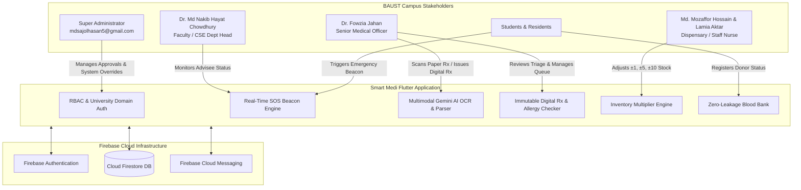
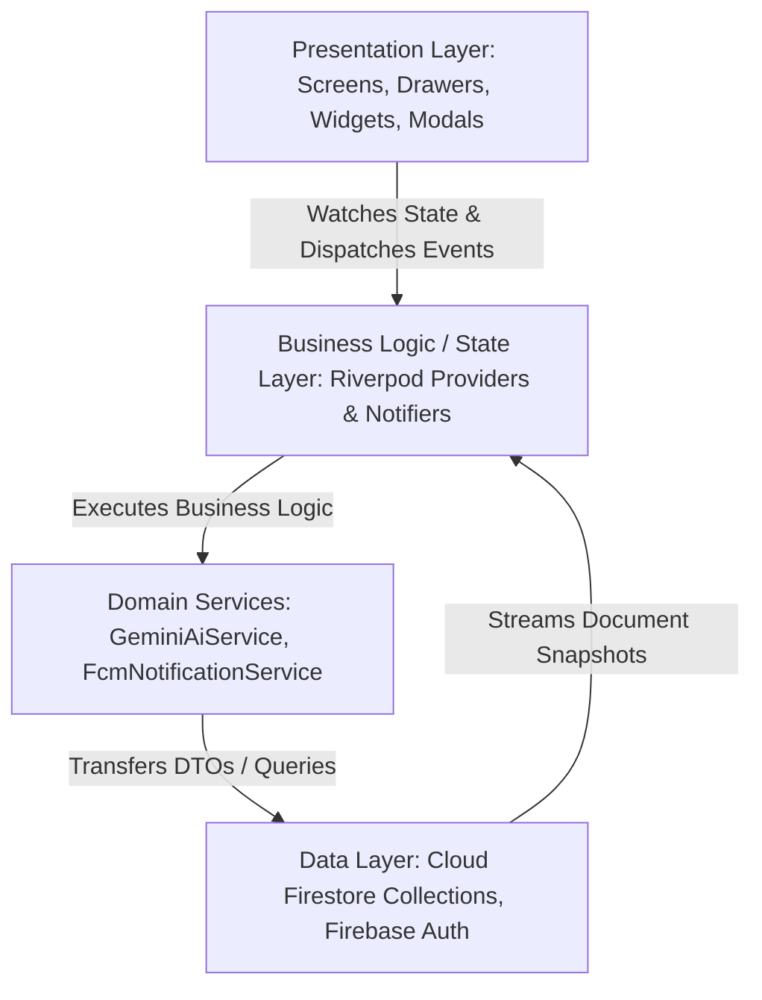
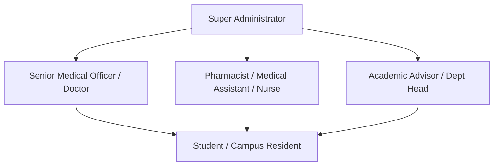
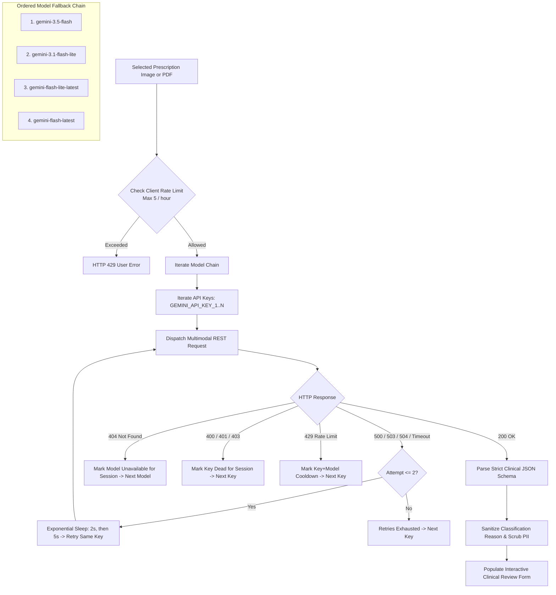
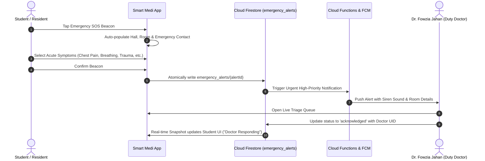
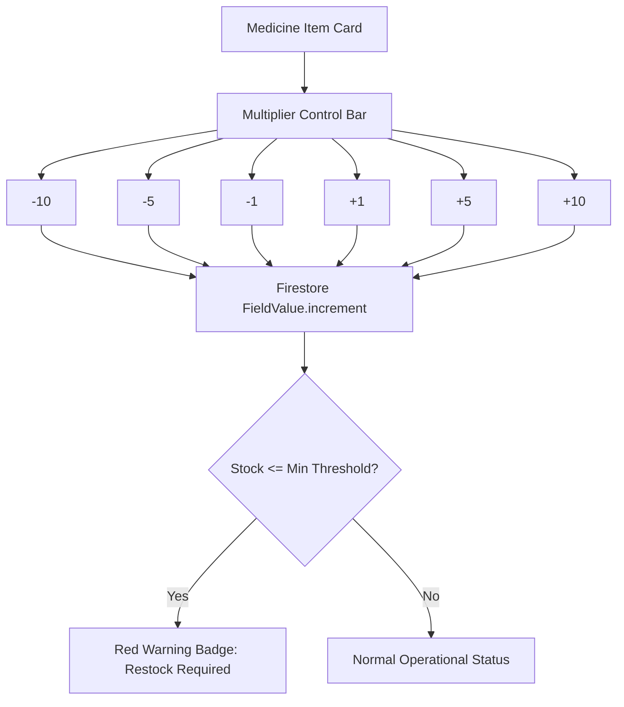
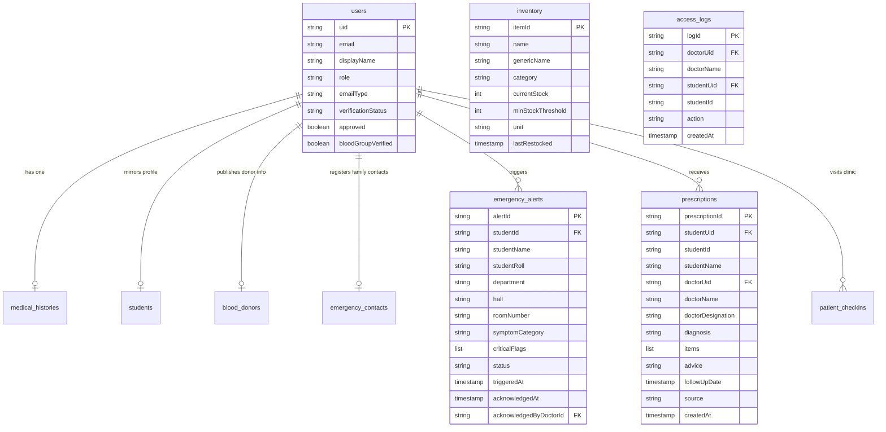

# Smart Medi: Comprehensive Technical Architecture & Project Documentation
**Institutional Medical Management & Emergency Healthcare Dispatch Platform**  
**Bangladesh Army University of Science and Technology (BAUST), Saidpur Cantonment**

---

```
  ███████╗███╗   ███╗ █████╗ ██████╗ ████████╗    ███╗   ███╗███████╗██████╗ ██╗
  ██╔════╝████╗ ████║██╔══██╗██╔══██╗╚══██╔══╝    ████╗ ████║██╔════╝██╔══██╗██║
  ███████╗██╔████╔██║███████║██████╔╝   ██║       ██╔████╔██║█████╗  ██║  ██║██║
  ╚════██║██║╚██╔╝██║██╔══██║██╔══██╗   ██║       ██║╚██╔╝██║██╔══╝  ██║  ██║██║
  ███████║██║ ╚═╝ ██║██║  ██║██║  ██║   ██║       ██║ ╚═╝ ██║███████╗██████╔╝██║
  ╚══════╝╚═╝     ╚═╝╚═╝  ╚═╝╚═╝  ╚═╝   ╚═╝       ╚═╝     ╚═╝╚══════╝╚═════╝ ╚═╝
```

---

## Table of Contents
1. [Project Overview & Objective](#1-project-overview--objective)
2. [Tech Stack & System Architecture](#2-tech-stack--system-architecture)
3. [Role-Based Access Control (RBAC) & Authentication Matrix](#3-role-based-access-control-rbac--authentication-matrix)
4. [Core Features & Clinical Workflows](#4-core-features--clinical-workflows)
   - [4.1 Multimodal Gemini AI Paper Prescription Scanner](#41-multimodal-gemini-ai-paper-prescription-scanner)
   - [4.2 Emergency SOS Beacon & Real-Time Triage Dispatch](#42-emergency-sos-beacon--real-time-triage-dispatch)
   - [4.3 Smart Campus Blood Bank & Donor Network](#43-smart-campus-blood-bank--donor-network)
   - [4.4 Pharmacy Inventory & Multiplier Dispensing Engine](#44-pharmacy-inventory--multiplier-dispensing-engine)
   - [4.5 Immutable Digital Prescriptions & Allergy Conflict Safety](#45-immutable-digital-prescriptions--allergy-conflict-safety)
5. [Enterprise UI/UX Design System](#5-enterprise-uiux-design-system)
   - [5.1 Visual Brand Identity](#51-visual-brand-identity)
   - [5.2 Global Navigation Shell (`SmartMediDrawer` & AppBars)](#52-global-navigation-shell-smartmedidrawer--appbars)
   - [5.3 Stateful Tab Routing (`IndexedStack`)](#53-stateful-tab-routing-indexedstack)
   - [5.4 Zero-Dependency Native Shimmer Skeleton UI](#54-zero-dependency-native-shimmer-skeleton-ui)
   - [5.5 University Faculty & Staff Accordion Directory](#55-university-faculty--staff-accordion-directory)
6. [Database Architecture & Firestore Security Rules](#6-database-architecture--firestore-security-rules)
   - [6.1 Entity-Relationship & Collections Schema](#61-entity-relationship--collections-schema)
   - [6.2 Production Security Rules & Defense-in-Depth Analysis](#62-production-security-rules--defense-in-depth-analysis)
   - [6.3 Clinical Audit Trails & Access Compliance](#63-clinical-audit-trails--access-compliance)
7. [Testing, Reliability & Verification](#7-testing-reliability--verification)
8. [Deployment & Operations Manual](#8-deployment--operations-manual)

---

## 1. Project Overview & Objective

### 1.1 Problem Statement
Higher education residential campuses operate under intense medical and logistics requirements. At the **Bangladesh Army University of Science and Technology (BAUST)**, situated in Saidpur Cantonment, hundreds of students, faculty, and administrative staff reside across military-administered dormitories and academic departments. 

Historically, campus healthcare relied heavily on paper-bound operational workflows:
- **Fragmented Medical Histories:** Students presented handwritten prescriptions from various external military or civilian hospitals. Records were frequently misplaced, leading to incomplete clinical context during acute clinic visits.
- **Critical Emergency Dispatch Delays:** In instances of severe midnight illness, trauma, or acute allergic reactions in residential halls (e.g., Shaheed Dr. Zikrul Haque Hall or Bir Protik Taramon Bibi Hall), notifying medical personnel and dispatching campus emergency aid required disorganized phone chains.
- **Prescription Ambiguity & Contraindications:** Illegible medical handwriting caused dosage misinterpretations, while lack of cross-checking against recorded patient drug allergies presented serious medical risks.
- **Blood Requisition Bottlenecks:** Emergency blood demands relied on manual, informal social media posts without donor verification, privacy protection, or department filtering.
- **Inventory Discrepancies:** The campus dispensary faced inaccurate stock counts and delays when logging medicine dispatches under manual ledger books.

### 1.2 The Smart Medi Solution
**Smart Medi** is a purpose-built, secure, military-grade campus healthcare and emergency dispatch ecosystem designed specifically for BAUST. It bridges students, resident medical officers, dispensary pharmacists, academic advisors, and administrative leadership into an integrated, real-time reactive platform.



---

## 2. Tech Stack & System Architecture

Smart Medi is engineered using Flutter for cross-platform responsiveness (Android, iOS, Web, Desktop) paired with a serverless Google Cloud / Firebase backend.

### 2.1 Core Technologies
| Category | Technology | Version | Purpose |
| :--- | :--- | :--- | :--- |
| **Framework** | Flutter | `>=3.x` | Reactive cross-platform UI framework |
| **Language** | Dart SDK | `^3.13.5` | Sound null-safe enterprise language |
| **State Management** | Flutter Riverpod | `^3.4.3` | Compile-time safe, testable reactive state container |
| **Authentication** | Firebase Auth | `^6.7.0` | OAuth 2.0 Google Sign-In & University Email verification |
| **Database** | Cloud Firestore | `^6.10.0` | Real-time reactive NoSQL document database |
| **Push Notifications**| Firebase Messaging| `^16.7.0`| APNs & FCM urgent dispatch and triage broadcasts |
| **AI Vision Engine** | Google Generative AI / Gemini REST | REST v1beta | Multimodal clinical OCR, timeline parser & entity extractor |
| **Document Export** | PDF & Printing | `^3.13.1` / `^5.15.1` | Vector-rendered bilingual medical prescription export |
| **Environment Config**| `flutter_dotenv` | `^6.0.1` | Local environment variable segregation (`.env`) |
| **Typography** | Noto Sans Bengali | Custom Asset | High-legibility Bengali script rendering |

### 2.2 System Architecture Layering



---

## 3. Role-Based Access Control (RBAC) & Authentication Matrix

Security at BAUST is governed by strict Role-Based Access Control implemented across both the Flutter client layer and enforced at the database level through Cloud Firestore Security Rules.

### 3.1 Role Hierarchy & Permissions



| Role | Target Users | Key Privileges | Firestore Guard |
| :--- | :--- | :--- | :--- |
| **Super Admin** | `mdsajolhasan5@gmail.com` | Global read/write bypass across all collections, account verification overrides, role elevation, system audits. | `isSuperAdmin()` via verified Google OAuth |
| **Doctor** | Dr. Fowzia Jahan (Senior Medical Officer) | View student medical histories (generates `access_logs`), acknowledge SOS alerts, issue immutable digital prescriptions, manage patient queue. | `isDoctor()` (`approved == true`, `role == 'doctor'`) |
| **Pharmacist / Nurse** | Md. Mozaffor Hossain (Medical Assistant), Lamia Aktar Limu (Staff Nurse) | Dispensary stock management with multiplier adjustments, stock logs, batch tracking, patient check-in recording. | `isPharmacist()` / `isMedicalStaff()` |
| **Student** | BAUST Enrolled Students | Trigger SOS beacon, manage personal health records, opt into blood donor registry, view issued digital prescriptions. | `isOwner(uid)` & `isMember()` |
| **Faculty / Advisor** | Dr. Md Nakib Hayat Chowdhury (CSE Dept Head) | Monitor assigned advisee emergency alerts, emergency contact escalation, directory access. | `isDoctor() \|\| isAdmin()` |

### 3.2 Dual-Track University Onboarding
1. **Institutional Domain Verification (`@baust.edu.bd`):**
   - Automatically verified upon email link validation.
   - Assigned `verificationStatus: 'verified'`, granting immediate campus directory and emergency features.
2. **Personal Domain Verification (`@gmail.com`, etc.):**
   - Requires institutional vetting. Enters a queue with `verificationStatus: 'pending'`.
   - Access to clinical data is gated until Super Admin or Medical Administration approves the profile.

---

## 4. Core Features & Clinical Workflows

### 4.1 Multimodal Gemini AI Paper Prescription Scanner
Doctors frequently encounter historical paper prescriptions written by hand or printed from disparate clinics. Smart Medi incorporates an enterprise-grade AI extraction pipeline in [`GeminiAiService`](lib/features/medical_onboarding_ai/data/services/gemini_ai_service.dart).



#### Multimodal Architecture Specifications
- **Model Chain Resilience:** Guaranteed continuity by falling back through `gemini-3.5-flash`, `gemini-3.1-flash-lite`, `gemini-flash-lite-latest`, and `gemini-flash-latest`. Prohibited models (`gemini-2.5-*`) are explicitly barred.
- **Fail-Safe Clinical Guardrails:**
  - Non-medical documents (invoices, resumes, certificates) are rejected: `is_medical_document == false` clears all clinical fields.
  - Ambiguous doctor handwriting is labeled `"Unverified - confirm with doctor"`.
  - Dedupes bilingual conditions (e.g., merging `Asthma` and `হাঁপানি` into `Asthma (হাঁপানি)`).
  - PII Protection: Private emails, phone numbers, and candidate names are scrubbed via regex from classification explanations.
  - Safe Manual Fallback: If all keys and models fail, the app surfaces a polite fallback: *"AI service is temporarily unavailable. You can continue by filling the form manually."*

---

### 4.2 Emergency SOS Beacon & Real-Time Triage Dispatch
The Emergency SOS system is engineered for zero-friction trigger under high-stress circumstances.



- **Residential Geolocation:** Pre-binds student hall data (e.g., *Shaheed Dr. Zikrul Haque Hall*, *Abbas Uddin Ahmed Hall*, *Bir Protik Taramon Bibi Hall*, or *Day Scholar*).
- **Triage Priority Flags:** Automatically flags high-risk clinical symptoms (`chest_pain`, `unconscious`, `severe_bleeding`, `breathing_difficulty`).

---

### 4.3 Smart Campus Blood Bank & Donor Network
The Blood Bank provides an on-demand, privacy-conscious donor directory across BAUST.

```mermaid
flowchart LR
    Donor[Student Blood Donor] -->|Toggles Availability| Reg[blood_donors/{uid}]
    Reg --> Query[Filter by Blood Group & Department]
    Query --> Chips[Verified Blood Group Badge]
    Chips --> Call[Direct Emergency Telephony Call]
```

- **Zero Data Leakage:** In accordance with Firestore rules, only non-sensitive fields are queryable (`uid`, `displayName`, `bloodGroup`, `department`, `hall`, `isAvailable`, `phone`).
- **Verified Clinical Badges:** A student cannot self-verify their blood group. The `bloodGroupVerified` boolean can only be set to `true` by an authorized medical officer or Super Admin.

---

### 4.4 Pharmacy Inventory & Multiplier Dispensing Engine
Dispensary management at the BAUST Medical Center requires rapid logging during morning clinic rush hours.



- **Stock Multipliers:** Pharmacists update stock using `±1`, `±5`, and `±10` increment/decrement buttons, eliminating repetitive manual keypad entry.
- **Batch & Expiry Auditing:** Tracks expiration dates, category segregations (Tablets, Syrups, Injections, First Aid), and min-stock thresholds.

---

### 4.5 Immutable Digital Prescriptions & Allergy Conflict Safety
Prescription issuance is restricted exclusively to verified doctors.

```mermaid
flowchart TD
    Doc[Doctor Input: Diagnosis & Items] --> CheckAllergy{Cross-check Patient History vs drug_allergy_map.dart}
    CheckAllergy -->|Conflict Detected| AllergyBanner[⚠️ Severe Warning: Patient Allergic to Drug Class]
    CheckAllergy -->|No Conflict| Clean[Proceed Safely]
    
    AllergyBanner --> OverrideCheck{Doctor Clinical Review}
    OverrideCheck -->|Amend Rx| Doc
    OverrideCheck -->|Confirm Override| Submit[Commit Digital Prescription]
    Clean --> Submit

    Submit --> WriteFS[Write to prescriptions/{prescriptionId}]
    RuleCheck{Firestore Security Rule Validation}
    RuleCheck -->|Immutable Rule: items 1..20, doctorUid == auth.uid| Stored[(Cloud Firestore)]
    Stored --> PDF[Vector PDF Export with Noto Sans Bengali & Print]
```

- **Immutable Clinical Audit:** Once written, prescriptions **cannot be updated or deleted** (`allow update, delete: if false;`).
- **Drug-Allergy Cross-Referencing:** Every prescribed medicine is evaluated against [`drug_allergy_map.dart`](lib/core/constants/drug_allergy_map.dart). If a patient has an allergy recorded for penicillin, cephalosporin, sulfa drugs, or NSAIDs, an urgent warning banner halts the flow before final issuance.
- **Bilingual PDF Export:** Utilizes `pdf` and `printing` libraries with `NotoSansBengali.ttf` embedding to render doctor signatures, patient demographics, and instructions.

---

## 5. Enterprise UI/UX Design System

### 5.1 Visual Brand Identity
The application visual system is modeled on BAUST’s military heritage and medical urgency standards:
- **Primary Military Green:** `#245122` (AppBar, active tabs, primary action buttons)
- **Army Green Dark:** `#173516` (Drawer headers, elevation overlays)
- **Army Green Light:** `#3F773C` (Sub-headers, chips, accent borders)
- **Emergency Crimson:** `#DC2626` (SOS beacon, low-stock warnings, allergy alerts)
- **Surface Neutral:** `#F6F8F5` (High-contrast, eye-friendly clinical surface background)

### 5.2 Global Navigation Shell (`SmartMediDrawer` & AppBars)
All portals incorporate a unified navigation shell:
- **Branded AppBars:** Display the official 1024px Smart Medi emblem alongside the active screen title, complete with screen-reader accessible tooltips.
- **Unified Side Drawer (`SmartMediDrawer`):** Features the user’s avatar, verified email badge, active role, route navigation, quick role-switching for authorized staff, and sign-out triggers.

### 5.3 Stateful Tab Routing (`IndexedStack`)
To eliminate frustrating screen re-renders during high-volume clinic shifts, staff portals utilize Flutter’s `IndexedStack`. Tab switching preserves scroll offsets, form draft inputs, and search query filters without discarding widget state.

### 5.4 Zero-Dependency Native Shimmer Skeleton UI
Rather than relying on unmaintained third-party packages, Smart Medi implements a native, 60 FPS hardware-accelerated shimmer effect in [`shimmer_loading.dart`](lib/core/widgets/shimmer_loading.dart) using Flutter’s native `AnimationController` and linear gradient shaders.

### 5.5 University Faculty & Staff Accordion Directory
The staff directory categorizes faculty members by academic departments using an accordion interface:
- **CSE Department Primacy:** As the core software and engineering patron, the **Computer Science & Engineering (CSE)** department is pinned first and expanded by default.
- Real campus leadership details are integrated directly from [`baust_constants.dart`](lib/core/constants/baust_constants.dart), including Dr. Md Nakib Hayat Chowdhury (Head of CSE) and Dr. Fowzia Jahan (Senior Medical Officer).

---

## 6. Database Architecture & Firestore Security Rules

### 6.1 Entity-Relationship & Collections Schema



### 6.2 Production Security Rules & Defense-in-Depth Analysis
The production Firestore security ruleset ([`firestore.rules`](firestore.rules)) enforces 316 lines of strict, least-privilege constraints:

1. **Absolute Super Admin Override:**
   ```javascript
   function isSuperAdmin() {
     return request.auth != null
       && request.auth.token.email_verified == true
       && request.auth.token.firebase.sign_in_provider == 'google.com'
       && request.auth.token.email == 'mdsajolhasan5@gmail.com';
   }
   ```
2. **Domain Regex Matcher:**
   Prevents spoofed subdomains using rigid regex boundary checking:
   ```javascript
   function isUniEmail() {
     return signedIn()
       && request.auth.token.email != null
       && request.auth.token.email.lower().matches('.*@([a-z0-9-]+\\.)*baust\\.edu\\.bd');
   }
   ```
3. **Immutable Digital Prescriptions:**
   Enforces item boundaries (1 to 20 medications), diagnosis length, verified doctor UID matching, and **completely forbids updates or deletions**:
   ```javascript
   match /prescriptions/{prescriptionId} {
     allow read: if isDoctor() || (isMember() && resource.data.studentUid == request.auth.uid);
     allow create: if isDoctor() && request.resource.data.doctorUid == request.auth.uid ...;
     allow update, delete: if false;
   }
   ```
4. **Student ID Claim Transactions (`student_ids/{id}`):**
   Prevents multiple student accounts from claiming the same institutional roll number.
5. **Default Deny:** All unmapped paths default to `allow read, write: if false;`.

### 6.3 Clinical Audit Trails & Access Compliance
Every time a doctor views a student's medical dossier or generates a digital prescription, an immutable audit event is written to `access_logs/{logId}` containing the doctor’s credentials, target student ID, action timestamp, and access type. These logs can only be audited by the Super Administrator.

---

## 7. Testing, Reliability & Verification

The Smart Medi codebase enforces complete regression stability across all unit, widget, and integration suites.

### 7.1 Automated Test Suites Summary
- **Total Test Cases:** 84 passing test cases (`0 failures, 0 errors`).
- **Core Coverage Areas:**
  - **Gemini Multi-Model Fallback & Rotation:** Verifies HTTP 503 retry behavior with mock clients, HTTP 429 key cooldown handling, HTTP 403 dead key marking, and HTTP 404 model skipping.
  - **Bengali Numeral & Date Parsing:** Validates conversion of Bengali digits (`০-৯`) and day-first date formatting.
  - **Clinical Safety & Deduplication:** Tests rejection of non-medical files and bilingual condition deduplication.
  - **RBAC & Authorization:** Validates Firestore rules simulation and route guard checks.
  - **Prescription & Allergy Map:** Tests cross-allergy detection against NSAIDs, penicillins, and sulfonamides.

```bash
$ flutter test
00:04 +84: All tests passed!
```

---

## 8. Deployment & Operations Manual

### 8.1 Environment Configuration (`.env`)
The application relies on multi-key API fallback defined in `.env` at the project root:
```env
# Google Gemini API Multi-Key Rotation Pool
GEMINI_API_KEY_1=your_primary_api_key_here
GEMINI_API_KEY_2=your_secondary_api_key_here
GEMINI_API_KEY_3=your_tertiary_api_key_here

# Firebase Configuration Flags
FIREBASE_ENV=production
```

### 8.2 Build & Deployment Commands
- **Flutter Web Build:**
  ```powershell
  flutter clean
  flutter pub get
  flutter build web --release --pwa-strategy=offline-first
  ```
- **Android APK / App Bundle Build:**
  ```powershell
  flutter build apk --release --split-per-abi
  flutter build appbundle --release
  ```
- **Deploying Firestore Rules:**
  ```powershell
  firebase deploy --only firestore:rules
  ```

---

*Smart Medi Project Documentation • Bangladesh Army University of Science and Technology (BAUST) • Engineering Lead: Sajol Hassan • Medical Lead: Dr. Fowzia Jahan*
