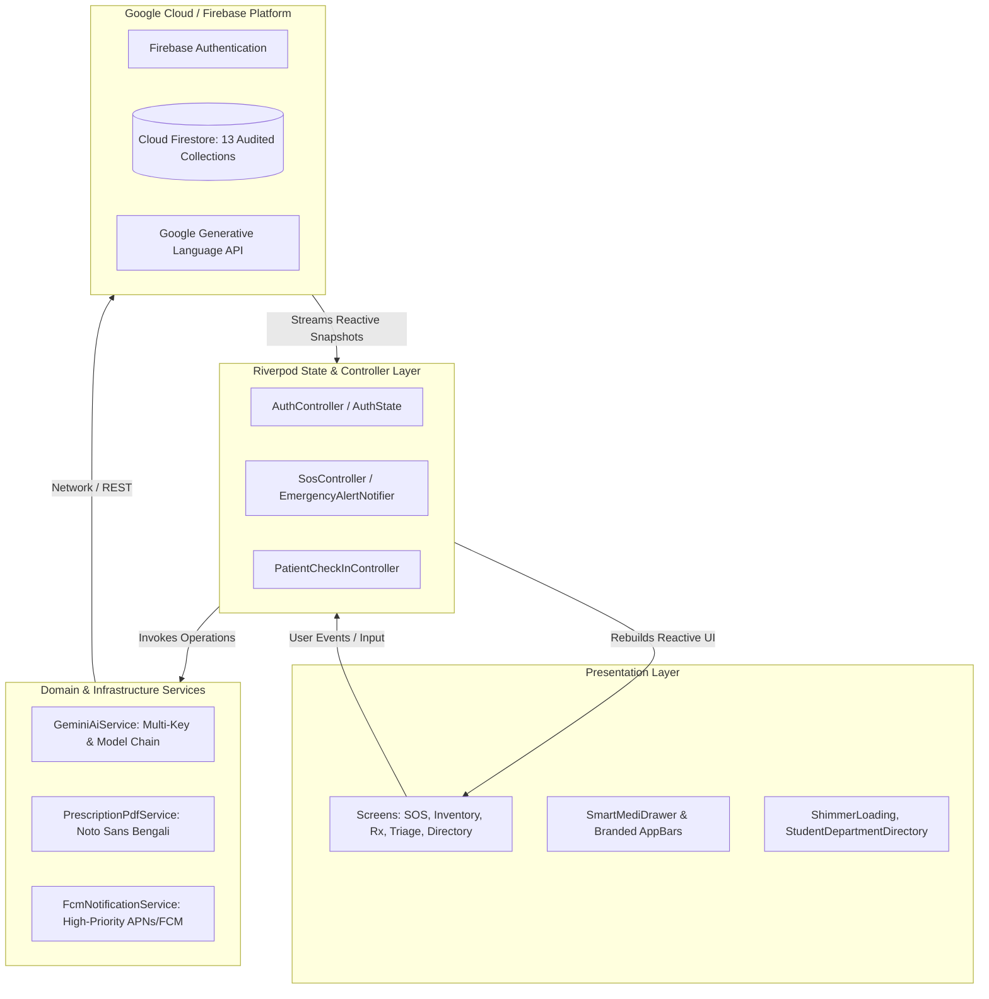
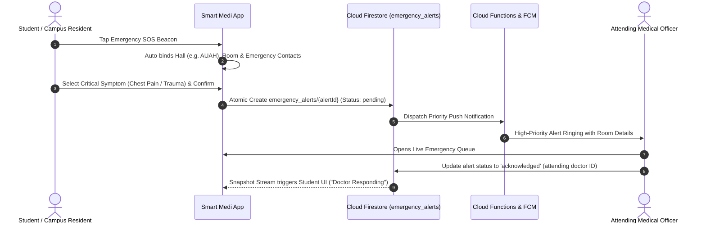

# Smart Medi — BAUST Medical Center
### Institutional Campus Healthcare, Multimodal AI Prescription Digitization & Real-Time Emergency SOS Dispatch Platform

[](https://flutter.dev)
[](https://firebase.google.com)
[](https://riverpod.dev)
[](https://ai.google.dev)
[](#contributors--acknowledgments)
[](#testing)

---

```
  ███████╗███╗   ███╗ █████╗ ██████╗ ████████╗    ███╗   ███╗███████╗██████╗ ██╗
  ██╔════╝████╗ ████║██╔══██╗██╔══██╗╚══██╔══╝    ████╗ ████║██╔════╝██╔══██╗██║
  ███████╗██╔████╔██║███████║██████╔╝   ██║       ██╔████╔██║█████╗  ██║  ██║██║
  ╚════██║██║╚██╔╝██║██╔══██║██╔══██╗   ██║       ██║╚██╔╝██║██╔══╝  ██║  ██║██║
  ███████║██║ ╚═╝ ██║██║  ██║██║  ██║   ██║       ██║ ╚═╝ ██║███████╗██████╔╝██║
  ╚══════╝╚═╝     ╚═╝╚═╝  ╚═╝╚═╝  ╚═╝   ╚═╝       ╚═╝     ╚═╝╚══════╝╚═════╝ ╚═╝
```

---

## 1. Project Overview & Objective

### 1.1 The Context & Problem Statement
The **Bangladesh Army University of Science and Technology (BAUST)**, situated within Saidpur Cantonment, hosts thousands of residential students, academic faculty, and military/civilian staff. Operating across military-administered residential dormitories—including **Shaheed Dr. Zikrul Haque Hall (SDZHH)**, **Abbas Uddin Ahmed Hall (AUAH)**, and **Bir Protik Taramon Bibi Hall (BPTBH)**—the campus frequently encounters mission-critical healthcare bottlenecks:

- **Fragmented Clinical Records:** Students present handwritten prescriptions from civilian and military hospitals. Paper slips are frequently lost, torn, or misplaced, leaving attending campus doctors without past medical records or known drug allergies.
- **Emergency Dispatch Delays:** Late-night medical emergencies in residential dorms (e.g., acute asthma attacks, trauma, allergic anaphylaxis) historically depended on disjointed phone calls and messaging chains, introducing critical delays.
- **Handwritten Rx Ambiguity & Drug Allergy Risks:** Illegible prescription handwriting risks medication misinterpretation, and the absence of real-time contraindication cross-referencing endangers patients allergic to common antibiotics (e.g., penicillins, cephalosporins) or NSAIDs.
- **Blood Requisition Bottlenecks:** Emergency blood demands on campus relied on informal social media broadcasts without donor verification, leading to panic, privacy leaks, and lost time.
- **Manual Dispensary Stock Ledgers:** Dispensary pharmacists logged medication disbursements manually on physical registers, making batch expiration audits and shortage predictions difficult.

### 1.2 The Smart Medi Solution
**Smart Medi** is a military-grade, reactive institutional healthcare ecosystem designed and engineered specifically for the BAUST community. It delivers:
1. **A One-Tap Emergency SOS Dispatch Beacon** connecting residential halls directly to attending medical officers.
2. **A Multimodal Gemini AI Prescription Scanner** with an ordered fallback chain (`gemini-3.5-flash` $\rightarrow$ `gemini-3.1-flash-lite` $\rightarrow$ `gemini-flash-lite-latest` $\rightarrow$ `gemini-flash-latest`), multi-key rotation, and clinical PII sanitization.
3. **An Immutable Digital Prescription System** with automatic drug-allergy contraindication detection and vector-rendered bilingual (Bengali/English) PDF export.
4. **A Real-Time Smart Blood Bank** with medical verification chips and privacy-shielded phone access.
5. **A Dispensary Inventory Engine** featuring rapid $\pm 1, \pm 5, \pm 10$ stock multiplier adjustments and low-stock alerts.

---

## 2. Key Features

### 🔐 Multi-Tier Role-Based Access Control (RBAC)
- **Granular Privilege Segregation:** 5 distinct user roles: **Super Admin**, **Doctor**, **Pharmacist / Medical Assistant / Nurse**, **Student / Resident**, and **Faculty / Academic Advisor**.
- **Dual-Track University Onboarding:**
  - `@baust.edu.bd` institutional accounts receive automatic email validation and immediate membership.
  - Personal email domains (`@gmail.com`, etc.) route to an administrative approval queue (`WaitingForApprovalScreen`).
- **Student ID Claim Transactions:** Firestore transactional verification ensures institutional roll numbers (e.g., `210401050`) cannot be duplicate-claimed or spoofed.

### 🤖 Multimodal Gemini AI Prescription & Document Scanner
- **Multimodal Document Processing:** Ingests JPG, PNG, WebP, and multi-page clinical PDF files.
- **Ordered Resilient Model Fallback Chain:**
  1. `gemini-3.5-flash` (Primary high-fidelity engine)
  2. `gemini-3.1-flash-lite` (Fallback 1)
  3. `gemini-flash-lite-latest` (Fallback 2)
  4. `gemini-flash-latest` (Fallback 3)
- **Multi-Key Quota & Rate-Limit Engine:**
  - Automatic session rotation across keys (`GEMINI_API_KEY_1..N`).
  - **HTTP 400 / 401 / 403:** Dead keys are flagged and skipped for the session without exposing credentials.
  - **HTTP 404:** Model is marked unavailable for the session and immediately advances to the next model.
  - **HTTP 429:** Key + model combinations are placed on cooldown.
  - **HTTP 500 / 503 / 504 & Timeouts (25s):** Retries the same key up to 2 times with exponential backoff (~2s, ~5s) before advancing.
- **Clinical Guardrails & PII Sanitization:** Non-medical documents (CVs, invoices, student IDs) are rejected. Handwritten text with high ambiguity is tagged `"Unverified - confirm with doctor"`. Bilingual conditions (e.g., `Asthma` and `হাঁপানি`) are deduplicated, and candidate names/emails/phones are scrubbed from classification reasons.

### 🚨 Emergency SOS Beacon & Real-Time Triage Dispatch
- **High-Urgency Dispatch Trigger:** One-tap SOS beacon pre-populated with the student's residential hall, room number, and emergency contact.
- **Clinical Triage Severity Flags:** Immediate tagging of acute medical emergencies: Chest Pain, Unconsciousness, Severe Bleeding, Breathing Difficulty, or Trauma.
- **Live Attending Queue:** Attending medical staff (Dr. Fowzia Jahan & duty assistants) receive real-time updates and acknowledge alerts with their doctor ID, instantly updating the student's screen with dispatch status.

### 🩸 Smart Campus Blood Bank & Donor Directory
- **Filtered Donor Discovery:** Query available campus blood donors by blood group (`A+`, `A-`, `B+`, `B-`, `AB+`, `AB-`, `O+`, `O-`) and academic department.
- **Privacy Protection (Zero-Leakage):** Strict Firestore rules restrict query results to safe fields (`displayName`, `bloodGroup`, `department`, `hall`, `isAvailable`, `phone`). Roll numbers and clinical histories are never exposed.
- **Verified Clinical Chip:** The `bloodGroupVerified` badge can only be confirmed by an authorized medical officer or Super Admin.

### 💊 Pharmacy Inventory & Multiplier Dispensing Engine
- **Rapid Multiplier Steppers:** Dispense or restock medicines during clinic rush hours using quick $\pm 1$, $\pm 5$, and $\pm 10$ steppers backed by atomic Firestore increments.
- **Low-Stock Warnings:** Real-time visual alerts when stock drops below minimum inventory thresholds.
- **Categorized Catalogs:** Organized tracking for Tablets, Syrups, Injections, First Aid, and Antiseptics.

### 📋 Immutable Digital Prescriptions & Allergy Conflict Safety
- **Tamper-Proof Record:** Digital prescriptions written to `prescriptions/{autoId}` can never be edited or deleted (`allow update, delete: if false;`).
- **Allergy Contraindication Shield:** Cross-checks prescribed medications against the patient's recorded drug allergies using `drug_allergy_map.dart` (Penicillins, Cephalosporins, Sulfonamides, NSAIDs/Aspirin).
- **Bilingual Vector PDF Generation:** Uses `pdf` and `printing` packages with `NotoSansBengali.ttf` font embedding to render print-ready clinical prescriptions with official doctor headers and clinic advice.

### 🩺 Patient Check-In & Medical Center Walk-In Queue
- **Real-Time Triage Log:** Tracks clinic walk-ins, consultation times, presenting complaints, and attending doctor assignments.
- **Shared Clinical Operations:** Accessible by doctors, staff nurses, and medical assistants.

### 👥 Department & Faculty Accordion Directory
- **Department Primacy:** Pinned **Computer Science & Engineering (CSE)** accordion section expanded by default.
- **Real Faculty & Staff Contacts:** Integrated directory of official university leadership, including Dr. Md Nakib Hayat Chowdhury (Head of CSE) and Dr. Fowzia Jahan (Senior Medical Officer).

---

## 3. Tech Stack & Tools

| Layer | Technologies & Packages | Purpose |
| :--- | :--- | :--- |
| **Core Framework** |   | High-performance, cross-platform client architecture |
| **State Management** |  | Compile-time safe, reactive dependency injection & state container |
| **Backend & Cloud** |    | Real-time reactive database, OAuth 2.0 Google Sign-In & push notifications |
| **AI Vision & LLM** |  | Multimodal clinical OCR, entity extraction, and multi-key fallback |
| **PDF & Printing** |   | Vector-rendered bilingual medical prescription export & print spooling |
| **Configuration** |  | Root `.env` credential loading with fail-safe zero-secret fallbacks |
| **UI Components** |  `shimmer_loading` | Custom native 60 FPS hardware-accelerated shimmer & military green theme |
| **Testing** |  | Mock HTTP testing, widget simulation, prompt heuristics verification |

---

## 4. System Architecture & Flow

### 4.1 Layered Architecture



### 4.2 Emergency SOS Dispatch Workflow



---

## 5. Folder Structure

```
smart_medi/
├── .env                                  # Environment variables (Gemini API keys)
├── firestore.rules                       # 316 lines of audited production security rules
├── pubspec.yaml                          # Package dependencies & asset configuration
├── assets/
│   ├── branding/                         # Official high-res Smart Medi brand icons (1024px)
│   ├── fonts/
│   │   └── NotoSansBengali.ttf           # Bengali typography for PDF prescriptions
│   └── images/
│       └── logo.png                      # Native splash & fallback iconography
├── scripts/
│   └── seed_emulator.js                  # Automated test user & collection seeder
├── test/                                 # 84 automated unit, widget, and mock HTTP tests
│   ├── digital_prescription_and_allergy_test.dart
│   ├── doctor_dashboard_patient_lookup_test.dart
│   ├── medical_center_inventory_sos_log_test.dart
│   ├── medical_document_parser_test.dart
│   ├── medical_onboarding_widget_test.dart
│   ├── phase1_auth_routing_test.dart
│   ├── phase1_dashboard_refactor_test.dart
│   ├── residency_and_prompt_intelligence_test.dart
│   ├── superadmin_and_detailed_history_test.dart
│   └── widget_test.dart
└── lib/
    ├── main.dart                         # Entry point: .env loading, Firebase init, Emulators
    ├── app.dart                          # App shell, theme config, dynamic RBAC route resolver
    ├── firebase_options.dart             # FlutterFire auto-generated configuration
    ├── core/
    │   ├── config/
    │   │   └── auth_config.dart          # Super Admin email definitions & domain regex
    │   ├── constants/
    │   │   ├── baust_constants.dart      # Halls, departments, authentic medical staff seed data
    │   │   └── drug_allergy_map.dart     # Pharmacological cross-reactivity mapping
    │   ├── services/
    │   │   └── fcm_notification_service.dart # Real-time emergency push notification client
    │   └── widgets/
    │       ├── shimmer_loading.dart      # 60 FPS native zero-dependency shimmer effect
    │       └── smart_medi_drawer.dart    # Unified enterprise side drawer across all portals
    └── features/
        ├── admin_portal/                 # Super Admin dashboard, audit logs & approvals
        ├── advisor_portal/               # Department head & batch advisor student health view
        ├── auth_rbac/                    # Login, Signup, Email Verification & Waiting screens
        ├── blood_bank/                   # Blood donor directory, availability & contact cards
        ├── dashboard/                    # Student 4-tab shell, medical history & profile views
        ├── emergency_sos/                # Emergency SOS beacon trigger & symptom triage
        ├── medical_onboarding_ai/        # Gemini AI document parser & student medical onboarding
        └── medical_operations/           # Doctor, Nurse, & Pharmacist clinical operations
            ├── data/
            │   ├── models/               # Prescription & PatientCheckIn models
            │   └── services/             # PrescriptionPdfService vector export
            └── presentation/             # Doctor dashboard, Rx issuer, Inventory, Check-in
```

---

## 6. Prerequisites

Before setting up Smart Medi locally, ensure your machine has the following tools installed:

1. **Flutter SDK:** Version `>=3.13.5` (Channel `stable`).
   ```bash
   flutter --version
   ```
2. **Dart SDK:** Included with Flutter.
3. **Android Studio** or **Visual Studio Code** with the official **Flutter** and **Dart** extensions.
4. **Java Development Kit (JDK):** Version 17 or higher (for Android builds).
5. **Node.js & npm:** (LTS version) Required to run Firebase CLI and emulator seeding scripts.
6. **Firebase CLI:**
   ```bash
   npm install -g firebase-tools
   firebase login
   ```
7. **Google Gemini API Key(s):** Obtain free or pay-as-you-go API keys from [Google AI Studio](https://aistudio.google.com/).

---

## 7. Step-by-Step Installation & Setup Guide

### Step 1: Clone the Repository
```bash
git clone https://github.com/your-username/smart_medi.git
cd smart_medi
```

### Step 2: Install Flutter Dependencies
```bash
flutter pub get
```

### Step 3: Configure Environment Variables (`.env`)
Create a `.env` file in the root directory:
```bash
cp .env.example .env   # Or create .env manually
```
Add your Gemini API key pool to enable multi-key fallback:
```env
# Google Gemini API Multi-Key Rotation Pool
GEMINI_API_KEY_1=your_primary_gemini_api_key_here
GEMINI_API_KEY_2=your_secondary_gemini_api_key_here
GEMINI_API_KEY_3=your_tertiary_gemini_api_key_here

# Firebase Environment Configuration
FIREBASE_ENV=production
```
*(Note: Smart Medi uses dynamic `dotenv.env` lookups with zero hardcoded credentials. If keys are missing, the app continues with a manual clinical form fallback).*

### Step 4: Configure Firebase
If connecting to your own Firebase project:
```bash
flutterfire configure
```
Select your Firebase project to regenerate `lib/firebase_options.dart`.

### Step 5: Deploy Firestore Security Rules
Deploy the audited security rules to your Firebase project:
```bash
firebase deploy --only firestore:rules
```

### Step 6: (Optional) Local Development with Firebase Emulators
To develop locally without touching production Firestore:
```bash
# Terminal 1: Start Firebase Emulators
firebase emulators:start

# Terminal 2: Seed test users and sample inventory
node scripts/seed_emulator.js

# Terminal 3: Run Flutter with emulator flag enabled
flutter run --dart-define=USE_EMULATORS=true
```

### Step 7: Run the Application
```bash
# Run on Chrome (Web)
flutter run -d chrome

# Run on connected Android device / emulator
flutter run -d android

# Run on iOS simulator (macOS required)
flutter run -d ios
```

---

## 8. Usage Guide & Role Walkthroughs

### 🎓 1. Student / Campus Resident Flow
1. **Sign Up:** Register using your `@baust.edu.bd` institutional email or Google account.
2. **Profile Onboarding:** Enter your Full Name, Student Roll (e.g., `210401050`), Department, and specify whether you are Residential (select Hall & Room) or Non-Residential.
3. **AI Medical History (Optional):** Upload any previous paper prescription or clinical PDF. Gemini AI parses active medications, diagnoses, and allergies automatically.
4. **Emergency SOS:** Tap the red **Emergency SOS** beacon from the main dashboard. Select your symptoms (e.g., *Chest Pain* or *Severe Breathing Difficulty*) and confirm. Attending doctors are alerted instantly.
5. **Blood Bank:** Toggle your blood donation availability from the Blood Bank tab to assist peers in medical emergencies.

### 🩺 2. Doctor Portal Flow (Dr. Fowzia Jahan & Medical Officers)
1. **Login:** Log in with an authorized medical officer account.
2. **Patient Lookup:** Enter a student's roll number to inspect their clinical timeline, past surgeries, and unverified blood group chips (audited via `access_logs`).
3. **AI Paper Prescription Scanner:**
   - Tap **Scan Paper Prescription** on the prescription screen.
   - Select a camera photo or PDF. Gemini AI runs OCR, extracts diagnoses, dosages, and frequencies, and populates the digital form.
4. **Issue Digital Prescription:** Review the pre-filled fields. The system automatically cross-checks for drug-allergy contraindications before committing.
5. **Export & Print:** Tap **Export PDF** to produce an official vector PDF with Bengali font support.

### 💊 3. Pharmacist Portal Flow (Md. Mozaffor Hossain & Staff Nurses)
1. **Inventory Management:** View current stock levels, medicine categories, and restock thresholds.
2. **Multiplier Dispensing:** Use the quick **-1**, **-5**, **-10** or **+1**, **+5**, **+10** buttons to adjust stock levels during clinic rush hours.
3. **Walk-In Check-In Log:** Record walk-in visits in the `patient_checkins` queue to track campus epidemiology.

### 🛡️ 4. Super Administrator Flow (`serviceprovidergalib@gmail.com`)
1. **Account Approvals:** Review external accounts (`@gmail.com`) in the approval queue and approve or reject them.
2. **Role Overrides:** Elevate staff members to Doctor, Pharmacist, or Faculty roles.
3. **Clinical Audit Inspection:** Audit `access_logs` to review which medical officers accessed student dossiers.

---

## 9. Testing & Quality Assurance

Smart Medi maintains a high test coverage bar across state management, AI prompt heuristics, Firestore rules simulation, and UI widgets.

```bash
# Run all automated test suites
flutter test

# Run code analysis & linter checks
flutter analyze
```

### Test Suite Coverage (84 / 84 Tests Passing)
- **`medical_document_parser_test.dart`:** Validates Gemini multimodal JSON parsing, bilingual condition deduplication (`Asthma` + `হাঁপানি`), day-first date formatting, Bengali numeral conversion (`০-৯`), PII scrubbing, and the multi-key/multi-model fallback chain (503 retries, 429 cooldowns, 403 dead key flags, 404 model skips).
- **`digital_prescription_and_allergy_test.dart`:** Tests drug-allergy cross-checking against Penicillins, Cephalosporins, Sulfonamides, and NSAIDs, form validation, and file size limits (rejects > 5 MB).
- **`doctor_dashboard_patient_lookup_test.dart`:** Tests student search, history rendering, and unverified blood group badge displays.
- **`medical_center_inventory_sos_log_test.dart`:** Tests $\pm 1, \pm 5, \pm 10$ inventory multipliers and patient check-in log workflows.
- **`superadmin_and_detailed_history_test.dart`:** Verifies Super Admin controls, live SOS monitoring, and clinical history filters.
- **`phase1_auth_routing_test.dart`:** Verifies RBAC route resolution and domain verification gates.

---

## 10. Contributors & Acknowledgments

Smart Medi is developed for and in collaboration with the healthcare and engineering community at **BAUST**:

### 👨‍💻 Engineering & Technical Leadership
- **Md. Sajol Hassan** — *Lead Software Engineer & System Architect*  
  Department of Computer Science & Engineering (CSE), BAUST  
  Email: `serviceprovidergalib@gmail.com`

### 🎓 Academic Patronage & Advisory
- **Dr. Md Nakib Hayat Chowdhury** — *Academic Advisor & Project Patron*  
  Head of Department (CSE) & Associate Professor  
  Bangladesh Army University of Science and Technology (BAUST)

### 🏥 Medical Center Staff & Clinical Consultation
- **Dr. Fowzia Jahan** — *Senior Medical Officer*, BAUST Medical Center
- **Md. Mozaffor Hossain** — *Medical Assistant*, BAUST Medical Center
- **Lamia Aktar Limu** — *Staff Nurse*, BAUST Medical Center

### 🏛️ Institution
**Bangladesh Army University of Science and Technology (BAUST)**  
Saidpur Cantonment, Saidpur — 5310, Nilphamari, Bangladesh  
Website: [www.baust.edu.bd](https://www.baust.edu.bd)

---

<p align="center">
  <b>Smart Medi</b> • Dedicated to the health, safety, and rapid emergency response of the BAUST community.
</p>
