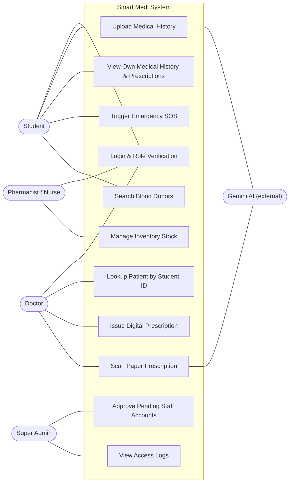
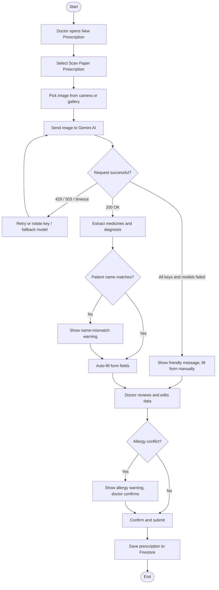
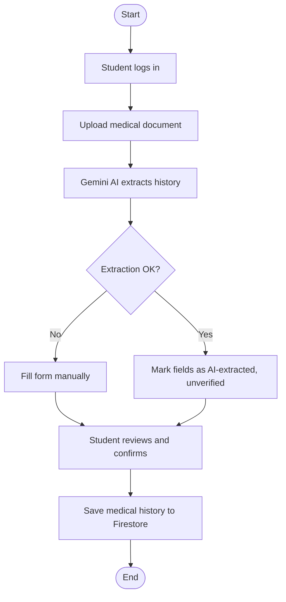
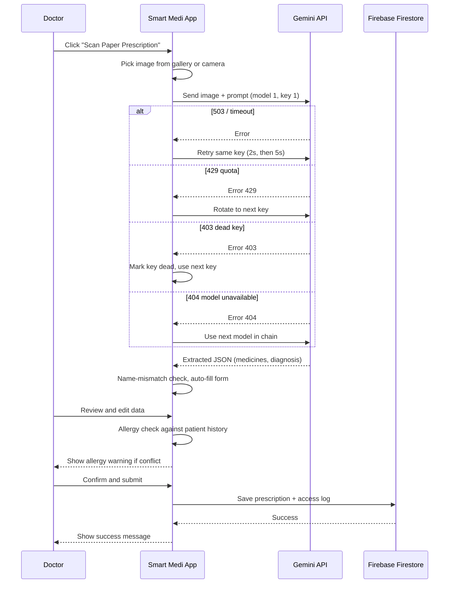
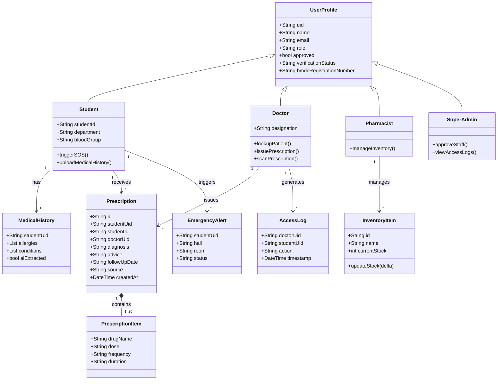

# Smart Medi – UML Diagrams

## 1. Use Case Diagram

## 2. Activity Diagram – Scan Paper Prescription

## 3. Activity Diagram – Student Medical History Upload

## 4. Sequence Diagram – Scan Prescription with Key and Model Fallback

## 5. Class Diagram

